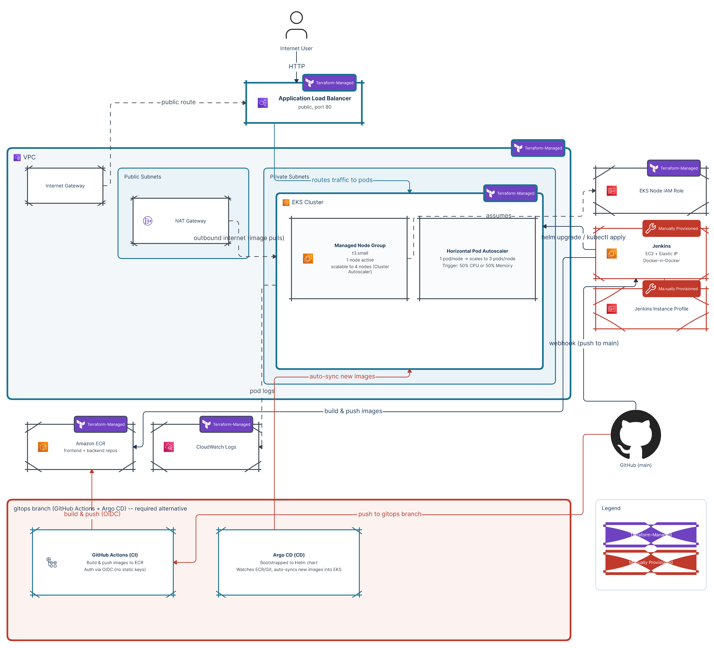

# Hello World App on EKS with Jenkins CI/CD + Autoscaling

A simple "Hello, World!" Node.js app, containerized, deployed to a fully
autoscaling Kubernetes cluster on AWS EKS, with a Jenkins pipeline that
builds, pushes, and deploys automatically on every push to `main`.

**Live app URL:** http://a75333337a516452a8ab1fdcb1325417-578362702.us-east-1.elb.amazonaws.com

---

## Architecture



```
Internet User
      |
      | HTTP
      v
Application Load Balancer (public, port 80)
      |
      v
VPC
  |-- Public Subnets  -> Internet Gateway, NAT Gateway
  |-- Private Subnets -> EKS Cluster
        |-- Managed Node Group (t3.small, 1 node -> scalable to 4)
        |     |-- scaled by Cluster Autoscaler (IRSA, watches ASG)
        |-- Horizontal Pod Autoscaler (1 pod/node -> 3 pods/node, 50% CPU)
      |
      v
CloudWatch Logs (pod logs)

GitHub (main branch)
      |
      | webhook (push)
      v
Jenkins (EC2, Docker-in-Docker)
      |
      | build & push images -> Amazon ECR
      | helm upgrade / kubectl set image -> EKS Cluster
      v
Amazon ECR (app repo)

GitHub (gitops branch) -- required alternative, no Jenkins involved
      |
      | push
      v
GitHub Actions (CI) -- build & push via OIDC, no static AWS keys
      |
      v
Amazon ECR
      |
      v
Argo CD (CD) -- watches ECR/Git, auto-syncs new images into EKS
```

The cluster runs on a t3.small managed node group (1 node active by
default, scalable to 4 via Cluster Autoscaler). Pods scale horizontally
via an HPA (1 to 3 pods per node, triggered at 50% CPU utilization).
Jenkins runs on its own EC2 instance, provisioned by Terraform alongside
the rest of the infrastructure (unlike the previous ECS project, where the
Jenkins instance was set up manually through the AWS Console). Only the
Jenkins software itself — installing Docker, running the Jenkins
container, configuring plugins/credentials — was done by hand once the
instance existed. Jenkins talks to the EKS cluster using an IAM role
mapped into the cluster's `aws-auth` ConfigMap, scoped to a custom
least-privilege Kubernetes ClusterRole rather than full admin access.

A separate `gitops` branch implements the required GitOps alternative:
GitHub Actions builds and pushes images to ECR via OIDC (no static AWS
keys), and Argo CD watches the Helm chart and auto-syncs new images into
the cluster.

---

## Prerequisites

- Docker
- AWS CLI v2, configured with credentials that have sufficient IAM
  permissions to create the resources below
- Terraform >= 1.5.0
- kubectl
- Helm
- Node.js / npm (for local app development)

---

## Repository Structure

```
.
├── app/              # Node.js "Hello, World!" application
├── terraform/        # All AWS infrastructure (EKS, VPC, IAM, ECR, Jenkins EC2)
├── k8s/              # Kubernetes manifests (Deployment, Service, HPA, RBAC)
├── Jenkinsfile        # CI/CD pipeline definition
├── docs/              # Architecture diagram
└── screenshots/        # Proof-of-work screenshots, organized by phase
```

---

## Setup & Deployment

### 1. Provision the infrastructure

```bash
cd terraform
terraform init
terraform plan
terraform apply
```

This creates: a VPC with 2 public + 2 private subnets across 2
Availability Zones, an EKS cluster with a managed node group, an ECR
repository for the app image, IAM roles (cluster, node group, Jenkins
instance, Cluster Autoscaler via IRSA), security groups, and a Jenkins
EC2 instance with an Elastic IP.

### 2. Connect kubectl to the new cluster

```bash
aws eks update-kubeconfig --name hello-world-eks --region us-east-1
kubectl get nodes
```

### 3. Install metrics-server (required for the HPA to read real CPU data)

```bash
kubectl apply -f https://github.com/kubernetes-sigs/metrics-server/releases/latest/download/components.yaml
```

### 4. Deploy the application

```bash
cd k8s
kubectl apply -f deployment.yaml
kubectl apply -f service.yaml
kubectl apply -f hpa.yaml
kubectl get svc hello-world-service
```

The `EXTERNAL-IP` column gives you the public LoadBalancer URL.

### 5. Wire up Jenkins RBAC access to the cluster

```bash
kubectl apply -f k8s/jenkins-rbac.yaml
kubectl apply -f k8s/aws-auth.yaml
```

This maps the Jenkins EC2 instance's IAM role into the cluster via a
custom `jenkins-deployer` ClusterRole — scoped to only Deployments,
Pods, Services, and HorizontalPodAutoscalers, not full cluster-admin.

### 6. Install Cluster Autoscaler

```bash
helm repo add autoscaler https://kubernetes.github.io/autoscaler
helm repo update

helm install cluster-autoscaler autoscaler/cluster-autoscaler \
  --namespace kube-system \
  --set autoDiscovery.clusterName=hello-world-eks \
  --set awsRegion=us-east-1 \
  --set rbac.serviceAccount.create=true \
  --set rbac.serviceAccount.name=cluster-autoscaler \
  --set "rbac.serviceAccount.annotations.eks\.amazonaws\.com/role-arn=arn:aws:iam::730335365330:role/hello-world-cluster-autoscaler-role" \
  --set extraArgs.balance-similar-node-groups=true \
  --set extraArgs.skip-nodes-with-system-pods=false
```

This uses IRSA (IAM Roles for Service Accounts) — the Cluster Autoscaler
pod assumes a dedicated, scoped IAM role via the cluster's OIDC
provider, rather than inheriting broad node-level permissions.

### 7. Jenkins setup

Jenkins runs as a Docker container on its own EC2 instance. The instance
itself, its Elastic IP, and its IAM role are all provisioned by
Terraform (see `main.tf`) — only the Jenkins software inside it was set
up by hand: Docker CLI, AWS CLI, kubectl, and Helm installed, then the
Jenkins container run and configured, so the pipeline can build images,
push to ECR, and deploy to EKS directly.

Jenkins credentials store holds: a GitHub Personal Access Token
(Username + Password kind, used for repo checkout and webhook auth) and
relies on the EC2 instance's own IAM role for AWS API access — no static
AWS access keys are stored in Jenkins.

A GitHub webhook (`http://<jenkins-ip>:8080/github-webhook/`, JSON
payload) triggers a new build automatically on every push to `main`.

---

## Terraform Explanation

| File | Purpose |
|---|---|
| `provider.tf` | AWS + TLS provider configuration |
| `main.tf` | VPC, subnets, EKS cluster, managed node group, Jenkins EC2, Elastic IP, OIDC provider |
| `security.tf` | Security groups and IAM role policies (cluster, nodes, Jenkins, Cluster Autoscaler) |
| `cluster-autoscaler.tf` | IRSA trust policy and least-privilege IAM policy for Cluster Autoscaler |
| `variables.tf` | All input variables |
| `outputs.tf` | ECR URL, cluster endpoint/name, Jenkins IP, VPC ID |

Key design decisions:

- **Least privilege everywhere.** Jenkins does not use `system:masters`
  inside the cluster — it uses a custom ClusterRole scoped to only the
  resources it needs to deploy. Cluster Autoscaler's IAM role is scoped
  to only Auto Scaling Group and EC2 describe/resize actions, via IRSA,
  not inherited node permissions.
- **`lifecycle { ignore_changes = [ami] }`** on the Jenkins EC2 instance
  prevents Terraform from replacing the whole instance every time AWS
  publishes a newer Amazon Linux AMI — without this, every `terraform
  plan` would show an unwanted instance replacement.
- **State is local** for this project (not a remote S3 backend). In a
  team/production setting this would move to an S3 backend with
  DynamoDB locking so multiple engineers/CI systems share one source of
  truth instead of risking state drift.

---

## Kubernetes & HPA Explanation

The Deployment runs 1 replica by default, with explicit CPU/memory
`requests` and `limits` set on the pod spec — this is required for the
HPA to calculate utilization percentages at all; without `requests` set,
the HPA has no baseline to measure against.

The HPA (`hpa.yaml`) watches average CPU utilization across all pods
behind the `hello-world-app` Deployment, scaling between 1 and 3 pods
when utilization crosses 50%. It has a built-in ~5 minute stabilization
window before scaling back down, to avoid "flapping" from brief traffic
dips.

The Service is `type: LoadBalancer`, giving the app a public AWS-managed
load balancer URL without needing to install the AWS Load Balancer
Controller or configure Ingress — a simpler, equally valid choice for an
app this size per the project's listed options.

---

## CI/CD Pipeline (Jenkins)

The `Jenkinsfile` runs four stages on every push to `main`:

1. **Checkout** — pulls the latest commit from GitHub
2. **Build Image** — builds the Docker image, tagged both with the
   Jenkins `BUILD_NUMBER` (unique per build) and `latest`
3. **Push to ECR** — authenticates to ECR and pushes both tags
4. **Deploy to EKS** — updates kubeconfig, then runs `kubectl set image`
   against the live Deployment with the new unique build-number tag, and
   waits for `kubectl rollout status` to confirm the new pods are
   healthy before finishing

**Why the unique build-number tag matters:** `kubectl apply` only
detects a change when the YAML text itself changes. If every build
pushed the same `:latest` tag, `kubectl apply` would see no difference
and silently skip the rollout — the cluster would keep running the old
image even though a new one was pushed to ECR. Using `kubectl set
image` with a unique tag per build forces Kubernetes to recognize a real
change and roll out new pods.

---

## Scaling Results

### Pod-level (HPA)

Under a sustained load test (`ab -c 250`), CPU utilization spiked to
249% against the 50% target, and the HPA scaled the Deployment from 1 to
3 replicas (its configured max) within about a minute. After the load
test ended, CPU dropped back under 1%, and the HPA automatically scaled
back down to 1 replica after its ~5 minute stabilization window.

### Node-level (Cluster Autoscaler)

To validate node-level autoscaling (not triggered by the default
3-pod-max config, since 3 small pods comfortably fit on one node), the
HPA's `maxReplicas` was temporarily raised to 20 for a heavier load test
(`ab -c 300 -t 300`). Pod count climbed past the t3.small instance's
practical pod-density limit, and Cluster Autoscaler automatically
provisioned 2 additional nodes (bringing the cluster to 3 of its
configured max of 4) to schedule the overflow pods. After the load test
ended, Cluster Autoscaler drained and terminated both extra nodes one at
a time, returning the cluster to its original single-node baseline.
`maxReplicas` was then reverted to its production value of 3.

See `screenshots/phase8/` for the full proof sequence (scale-up and
scale-down, pod-level and node-level).

---

## GitOps Branch (Phase 10)

A separate `gitops` branch implements the required GitOps alternative to
the Jenkins pipeline, keeping CI (build) and CD (deploy) fully
separated: GitHub Actions never holds direct cluster-access credentials
— only Argo CD, running inside the cluster, does.

```
.
├── .github/workflows/deploy.yml   # GitHub Actions CI (build & push only)
├── helm/                          # Helm chart for the app (Chart.yaml, values.yaml, templates/)
└── argocd/application.yaml        # Argo CD Application CRD
```

**GitHub Actions (CI)** triggers on every push to `gitops`:

1. **Checkout** the repo
2. **Configure AWS credentials via OIDC** — assumes
   `hello-world-github-actions-deploy-role` via
   `sts:AssumeRoleWithWebIdentity`, no static AWS keys stored in GitHub.
   The IAM role's trust policy is scoped to this exact repo and branch,
   and its permissions policy is scoped to ECR push actions only.
3. **Build the Docker image**, tagged with the short commit SHA
4. **Push to ECR**
5. **Update `helm/values.yaml`** with the new image tag (`sed`)
6. **Commit and push** that change back to `gitops` as
   `github-actions[bot]`, with `[skip ci]` to avoid re-triggering itself

**Argo CD (CD)** runs entirely inside the cluster (`argocd` namespace)
and watches the Helm chart on the `gitops` branch via the
`hello-world-app` Application resource. `syncPolicy.automated` has
`prune` and `selfHeal` enabled, so every new commit to `helm/values.yaml`
is detected and deployed automatically — no `kubectl` or `helm` command
run by a human, and the GitHub Actions side never touches the cluster.
Argo CD authenticates to the private repo with its own separate
credential (a GitHub PAT over HTTPS, configured under Settings →
Repositories) — a completely different trust relationship from GitHub
Actions' OIDC, which only covers the AWS side.

**Verified end-to-end:** a visible text change was pushed to `gitops`
and the full chain was watched firing in real time — the GitHub Actions
run succeeding, the bot's commit bumping the Helm tag, Argo CD flipping
from `Synced` to `OutOfSync` and back to `Synced`/`Healthy`, and the new
text confirmed live via `curl` against the same LoadBalancer URL used by
the Jenkins path. `kubectl get pods`/`get svc` was also run directly
against the cluster to independently confirm the live pod and Service,
rather than trusting the Argo CD dashboard alone.

**Issue hit along the way:** GitHub's OIDC token embeds immutable
numeric account/repo IDs alongside the plain-name format in its `sub`
claim (`repo:OWNER@ACCOUNT_ID/REPO@REPO_ID:ref:refs/heads/BRANCH`), not
just `repo:OWNER/REPO:ref:refs/heads/BRANCH`. The initial trust policy
used the plain-name format and was rejected with `AccessDenied`;
diagnosed via AWS CloudTrail Event history to read the exact identity
string AWS received, then fixed by correcting the `sub` condition to
match.

See `screenshots/phase10/` for the full proof sequence.

---

## Repository Access

This is a private repository, shared with a collaborator for
review and feedback.
